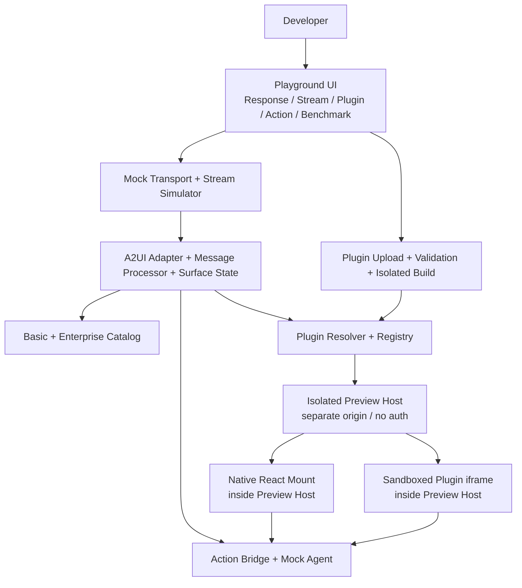

# Enterprise Agent UI Runtime & Plugin Playground — MVP 1.0

> **Codex 开发 Handoff / PRD + Architecture + Implementation Plan**  
> 文档版本：1.0 · 日期：2026-11-13 · 状态：MVP Scope Confirmed / Ready for Implementation  
> 目标读者：Codex、前端工程师、平台架构师、测试工程师

---

## 0. 给 Codex 的执行摘要（先读）

构建一个**可独立运行的 React + TypeScript Agent UI Playground**：开发者粘贴/导入 Agent 返回的 **A2UI JSON 或 JSONL**，Playground 调用 A2UI 官方 Core / React Renderer 展示 UI；通过 Stream Simulator 分步播放、暂停、调速、重放；开发者可以上传**任意符合本 MVP 受控依赖规范的 TSX/ZIP Plugin 源码**，平台编译后**无需重新部署应用即可动态预览**；同一个上传的 Plugin 可自由选择 **Native React** 或 **Sandboxed iframe** 执行模式，并比较结果、交互和性能。

**必须交付两个真正通过上传入口安装的插件：**

1. `finance.risk-heatmap`：Risk Heatmap，验证**自定义可视化 + progressive/live streaming + drilldown action**。
2. `expense.approval-form`：Expense Approval Form，验证**on_complete/deferred rendering + 表单输入 + action/result + 状态更新**。

**MVP 不依赖真实 LLM、企业 SSO、真实 Orchestrator、数据库，也不执行真实审批。** 使用 JSON/JSONL Fixtures 和 Mock Action Simulator，但接口设计必须能够以后无痛接入企业 Multi-Agent Orchestrator。

**最高优先级约束：**

- 不能只做“两个插件的硬编码演示”。必须提供真实上传、服务端编译、动态注册、加载、卸载、重新上传流程；再用一个**未知第三插件**证明系统通用。
- Playground 内允许**任何通过语法/Schema/依赖白名单验证的上传插件**测试两种 Runtime Mode。注意这不等于可以跳过安全限制；**Native 必须运行在与主 Playground 隔离的 Preview Host**，绝不能把不受信任的代码直接 `import()` 到主 Playground 的 JS 上下文。
- `Native` 与 `Sandbox` 使用**同一份 Plugin API/输入/Action 契约**，只改变运行隔离层。切换时销毁旧实例、重建新实例、重置/恢复相同测试快照。
- **A2UI 官方 Wire Protocol 与我们的扩展不得混淆。** 原始 A2UI 消息不附加自创的 `component.complete` 等伪官方事件；测试完成信号可以通过平台测试驱动中的 Scenario Metadata，或 A2UI Data Model 的 `ready` 字段表达。
- TypeScript strict，避免 `any`；功能必须可测试，不以静态 Mockup 冒充已实现能力。

---

## 1. 产品背景与定位

现有企业 Agent 体系（未来接入）：

```text
Enterprise React Chat UI
         ↕ UI content / actions / stream
Multi-Agent Orchestrator
         ↕
Domain Agents: HR / Finance / Expense / BI / others
```

目标是把**Agent UI Rendering**提取为可复用框架：Agent 只返回经过标准化的声明式 UI 消息和数据，渲染层由 Runtime 负责；特殊 UI 通过 Plugin 开发、上传并动态装载。Playground 是这套框架的开发/测试/调试入口，不是唯一 Host。未来 `ui-runtime` 应可被嵌入现有 Chat UI、Side Panel 和 Full Workspace。

**MVP 核心验证问题**：

1. 标准 A2UI 消息是否能被正确解析并渲染基本组件？
2. 多条 A2UI 消息是否能够渐进更新同一个 Surface/Data Model？
3. 自定义组件是否能通过 Schema/Catalog 与 A2UI 集成？
4. 不修改 Playground 源码，上传新 TSX/ZIP 是否可立即渲染？
5. 同一个 Plugin 能否在 Native/Sandbox 两种模式下运行？
6. 数据未完成时是否能延迟渲染；完成后是否正确展示并交互？
7. UI 中操作能否回传成标准 Action，并由 Mock Agent Response 驱动下一次渲染？
8. 错误是否被限制在单个 Plugin/Surface 内，而不会拖垮整体 Playground？

### 1.1 范围（In Scope）

- A2UI 1.0 JSON / JSON Array / JSONL 粘贴、导入、解析、校验、错误定位、渲染。
- Stream Simulator：Play/Pause/Step/Reset、间隔/速度调整、逐事件日志、重放。
- Core Component Gallery：A2UI Basic Catalog（按实际 SDK 支持范围）+ 少量企业扩展。
- Enterprise Catalog MVP：KPI/Statistic、DataTable、Chart（Line/Bar/Pie）。
- Plugin 源码上传（`.tsx`、`.zip`）、受控编译、临时注册、动态预览。
- Playground Runtime Mode：`native` / `sandbox` 可切换。
- Plugin SDK：props、state updates、host actions、theme、error reporting、resize。
- Action Inspector + Mock Agent Action Result / UI update。
- Streaming Policy：`progressive`、`on_complete`、`live`（我们的平台约定）。
- 两个 Demo Plugins，另加第三未知插件泛化测试。
- 单插件和模式对比的基础 Benchmark。
- 自动化单元、集成、端到端测试及关键安全测试。

### 1.2 明确不做（Out of Scope）

- 真实多 Agent Orchestrator 联调、真实模型调用。
- 企业级 Marketplace、真实组织权限、SSO、审批发布流程。
- 插件依赖任意 NPM 包、自定义 build scripts、执行未知 `postinstall`。
- 跨会话云端持久化、共享协作、多租户计费。
- 任意第三方插件直接获得宿主认证 Token、网络权限、文件系统权限。
- 生产级插件签名、跨多个生产版本兼容管理（预留接口即可）。

---

## 2. 技术基线与需核实事项

### 2.1 官方 A2UI vs 本项目自定义

| 能力 | 性质 | 所属层 |
|---|---|---|
| `createSurface` / `updateComponents` / `updateDataModel` / `deleteSurface` | A2UI v1.0 Wire Protocol | 官方 SDK |
| Surface、Data Model、Catalog、绑定、Action | A2UI 能力 | 官方 SDK / React Renderer |
| `PluginManifest` / 上传编译 / 动态加载 | 自定义实现 | Plugin Platform |
| `native` vs `sandbox` 模式 | 自定义实现 | Preview Host / PluginHost |
| `renderPolicy`、`readyWhen` / `on_complete` | 自定义实现 | Render Policy Coordinator |
| Stream Playback/Chaos Mode / Benchmark | 自定义实现 | Playground |
| `plugin.action` 与 Host Bridge | 自定义适配 | Action Bridge |

**版本风险提醒：** 官方文档中协议版本与不同 Renderer 的发布状态可能变化甚至出现不同步。Codex 开发开始时**必须先验证已发布的 `@a2ui/react` / `@a2ui/web_core` 版本、React Renderer 对 v1.0 的支持、导出 API、Catalog 注册方式、示例代码**。优先直接运行官方 React sample 的工作版本，再锁定精确依赖版本。若 v1.0 协议已支持但 React Renderer 部分接口尚未落地，应保留适配层；不要擅自把 v0.9.1 JSON 当作 v1.0，也不要虚构 npm API。以实际 SDK + Conformance 测试结果为准。

**目前可核对的官方入口（开发时重新验证）：**

- [A2UI 官方 GitHub](https://github.com/a2ui-project/a2ui)
- [官方 React Client Integration](https://a2ui.org/guides/client-integration/)
- [官方 Messages Reference](https://a2ui.org/concepts/messages/)
- [Catalog 定义指南](https://a2ui.org/guides/defining-a-catalog/)
- [官方 SDK 说明](https://a2ui.org/concepts/sdks/)
- [Basic Catalog](https://a2ui.org/specification/v1.0-basic-catalog-implementation-guide/)

### 2.2 建议技术栈

| 层 | 建议 |
|---|---|
| Monorepo | pnpm workspaces（可用 Turborepo，但不是必需） |
| Frontend | React + TypeScript(strict) + Vite |
| A2UI | 官方 `@a2ui/react` + `@a2ui/web_core`，精确锁版本 |
| Editor | Monaco Editor（JSON/JSONL 编辑、错误标注） |
| UI | shadcn/ui / Radix、企业 Token，必要时配合 Tailwind |
| DataTable | TanStack Table |
| Chart | Apache ECharts（任选 React wrapper） |
| Playground State | Zustand；A2UI 自己的 Surface/Data Model 不再重复存一份不一致的状态 |
| Upload/Build API | Node.js + TypeScript（Fastify 或类似轻服务） |
| Build | esbuild；只使用受控构建配置，隔离编译 |
| Schema | JSON Schema + Ajv，复用官方 A2UI 验证 |
| Test | Vitest、React Testing Library、Playwright |
| Metrics | Performance API、React Profiler、通信序号/时间戳 |

---

## 3. 总体架构



**边界原则：**

1. **主 Playground：**拥有编辑器、文件上传、性能面板；不加载用户提供的 JS。
2. **A2UI Adapter：**只接收/转换已校验 A2UI 消息；对外通过简洁的 Provider/Surface API 暴露。
3. **Plugin Registry：**把 `catalogId + componentType + pluginId + version` 解析到受控插件制品。
4. **Isolated Preview Host：**部署于与主 Playground 独立的站点/Origin，不存认证凭据和敏感数据。
5. **Native Mode：**插件与 Preview Host 的 React App 运行在同一 JS 上下文，**不是**主 Playground 的 JS 上下文。
6. **Sandbox Mode：**插件在 Preview Host 里的更深一层受限 iframe 运行，通过 MessageChannel 与 Preview Host 通信。
7. **Action Bridge：**不信任客户端声称的 Action/Agent 权限；MVP 只做 Mock，正式系统再接服务端授权。

**本地开发隔离：**可使用 `localhost:5173` 运行主 Playground、`127.0.0.1:4173` 运行隔离 Preview Host（并在浏览器中验证真正的 Origin/Site 边界）；生产必须使用安全隔离的独立站点，且不能共享认证 Cookie/Token。仅不同端口不足以确保站点级 Cookie 隔离。

---

## 4. Playground 页面与交互

### 4.1 页面布局

桌面端 3 栏、窄屏支持 Tab 切换：

- **左：Source / Input**：Monaco 编辑器；示例选择；输入 A2UI JSON、JSON Array、JSONL；导入文件；校验；Schema 错误高亮。
- **中：Preview**：切换 Chat Bubble / Card / Workspace；Theme Light/Dark；响应式宽度；切换 Plugin Native/Sandbox；错误占位、Loading、实际组件。
- **右：Inspector**：Events、Surface Tree、Data Model、Actions、Plugin Logs、Performance Metrics。

导航包含 5 个子工作区：

1. **Response Studio**：复制/粘贴 Agent 响应、验证、渲染。
2. **Stream Simulator**：播放/暂停/逐帧/重置/回放、更新频率、消息时间轴、重连模拟。
3. **Plugin Studio**：上传源码、构建输出、插件列表、切换运行模式、卸载、重新编译。
4. **Action Inspector**：接收 UI Action、查看 Payload、执行 Mock Rule、产生后续 A2UI 更新。
5. **Component Gallery / Benchmarks**：基础/扩展组件示例；Native/Sandbox 性能测试。

### 4.2 Plugin Studio UX

- `Upload .tsx / .zip`，显示大小限制和允许的依赖清单。
- Build Status：`validating → building → ready` / `failed`，展示可定位到文件/行号的错误。
- Plugin ID、version、组件类型、Catalog ID、Schema、支持的 Actions。
- 单选 `Native React` / `Sandboxed iframe`，以及 `Compare Both`。
- `Render` 按钮；切换运行模式时重新 mount，使用相同 Fixture / Event Replay。
- `Unload`、`Replace Upload`、`Reset State`、`Inspect Logs`。
- 明确标记：Native 是在**隔离 Preview Host**中执行，并非可信生产环境授权。

### 4.3 组件模板入口（2026-11-13 讨论补充）

- Playground 默认流程为：选择组件 → 填写模板 → 渲染 → 交互验证。
- 左侧按类别分区，以 Icon + 名称显示基础展示、数据展示、表单交互和已上传插件。
- 中间提供模板表单与 A2UI JSON 编辑；右侧显示实际组件预览。第 4.1 节的 Source/Inspector 是可展开的高级调试能力。
- 一个组件可以提供完整数据、渐进加载、持续更新、交互响应等多个场景模板；多消息模板按步骤配置数据、顺序和间隔。
- 表单与 JSON 共享同一模板数据；复杂手写 JSON 无法映射回表单时明确显示 JSON 编辑模式。
- 模板通过 Catalog/Schema/Fixture 元数据发现，不硬编码两个 Demo Plugin；简单字段生成表单，复杂输入保留 JSON 编辑。
- 模板应可导出实际 A2UI 消息及 API 接入示例，与 Agent 接入 API 共用实例化与校验逻辑。

---

## 5. A2UI 输入协议、Streaming 与状态

### 5.1 输入格式

支持：

- **Single JSON**：一条合法 A2UI Message。
- **JSON Array**：多条合法 A2UI Message，按顺序应用。
- **JSONL**：每行一条合法 A2UI Message，可从文件逐行 Replay。
- **SSE Mock**：由一个适配器模拟网络事件（MVP 可先内部模拟，再提供 `ReadableStream` 接口）。

无论源格式如何，进入官方 Message Processor 前都要验证：版本、Message 类型、Schema、Surface ID、最大体积、事件顺序。**每个 JSONL 行才是一条完整消息；网络 Chunk 并不天然等于一行/一条消息。**

### 5.2 官方 v1.0 示例（可作为 Fixture）

以下三行使用官方 v1.0 的 `createSurface` 与 `updateDataModel` 结构，作为 JSONL 样例（具体运行需通过已锁定的 SDK 校验）：

```jsonl
{"version":"1.0","createSurface":{"surfaceId":"demo-title","catalogId":"https://a2ui.org/specification/v1_0/catalogs/basic/catalog.json","components":[{"id":"root","component":"Column","children":["title"]},{"id":"title","component":"Text","text":{"@path":"/headline"}}],"dataModel":{"headline":"Preparing financial report..."}}}
{"version":"1.0","updateDataModel":{"surfaceId":"demo-title","path":"/headline","value":"Analyzing data..."}}
{"version":"1.0","updateDataModel":{"surfaceId":"demo-title","path":"/headline","value":"Financial report completed."}}
```

**这三行是正式 A2UI 消息**。以下仅为本系统的 Scenario/Preview 配置，**不是 A2UI Wire Protocol**：

```json
{
  "scenarioId": "expense-deferred-demo",
  "surfaceId": "expense-demo",
  "pluginId": "expense.approval-form",
  "runtimeMode": "sandbox",
  "renderPolicy": "on_complete",
  "readyWhen": "/renderState/complete",
  "frameIntervalMs": 300
}
```

### 5.3 Rendering Policy（平台扩展）

| Policy | 行为 | 使用者 |
|---|---|---|
| `progressive` | 数据部分到达即可显示，继续增量补全 | 表格、Heatmap、文本 |
| `on_complete` | 缓存变化，`readyWhen` 满足且 Schema 有效后才显示正式组件 | Approval、完整图表、复杂表单 |
| `live` | 初次 Ready 后持续订阅后续更新 | 运行进度、风险监控 |

- `renderPolicy` 是平台对**组件实例/预览场景**的配置，不修改官方 A2UI Message Schema。
- `readyWhen` 使用 JSON Pointer 指向 Surface Data Model 的一个布尔字段（示例 `"/renderState/complete"`）。
- `on_complete` 未就绪时显示 Skeleton/Waiting；超时进入 Error/PartialResult 状态，绝不能自动批准或提交表单。
- 同一 Surface 可有多个不同策略的组件；Message 完成 ≠ 每个组件完成。
- `Reset` 清理 Surface、数据模型、未完成定时器和插件状态；`Pause` 不丢事件。
- 事件由 Adapter 有序喂入处理器，记录 seq + 原始 payload + 本地接收时间；缺失/重复/非法消息需要可见错误。

### 5.4 建议 Transport Adapter 合同（自定义，不是官方导出 API）

```ts
export interface PlaybackEvent {
  id: string;
  sequence: number;
  payload: unknown;       // validated A2UI message
  delayMs?: number;
}

export interface AgentUITransport {
  subscribe(onMessage: (event: PlaybackEvent) => void): () => void;
  dispatchAction(action: unknown): Promise<unknown>;
}
```

以后 Multi-Agent Orchestrator 可通过 SSE/WS Adapter 实现相同的接口。

---

## 6. Core / Enterprise Component Catalog

### 6.1 MVP 支持范围

**官方 Basic Catalog**：优先直接复用当前 React Renderer 已实现的 Text、Row、Column、Card、Button、TextField、ChoicePicker、Checkbox、Tabs 等常用控件；所有具体名称/Props 以锁定版本为准。

**企业自定义 Catalog 最小集合：**

| Component | 能力 | Streaming |
|---|---|---|
| `enterprise.KPI` | 标题、值、单位、同比/趋势、状态 | Progressive |
| `enterprise.DataTable` | 标题、列定义、行数据，基础排序（MVP 客户端）、行点击 Action | Progressive |
| `enterprise.Chart` | Bar/Line/Pie、Legend、Tooltip、点击 Action | On-complete / Live |
| `enterprise.PluginHost` | 通过 Registry 装载 Plugin、Props/状态传输、Action Bridge | 按 Plugin Policy |

可使用 ECharts、TanStack Table 构建以上组件，但**Catalog 中暴露的数据 Schema 必须简单且可校验**，不要暴露整个第三方图表库的原生配置对象；避免 Agent 产生任意 JS 表达式/事件处理函数。

### 6.2 Catalog 管理

- 有 `catalogId`、`componentType`、`version`、JSON Schema、renderPolicy 默认值。
- Core/Enterprise Component 可被同一个 A2UI Surface 组合使用；注册方式参考官方 v1.0 Catalog 约定。
- Unknown component 或不匹配的 Schema 显示错误卡，不崩溃。
- Plugin 向 Catalog 注册**明确的自定义组件类型**；可以在运行时由 Registry Resolver 查到 React 实现。

---

## 7. Plugin SDK / Packaging / Runtime

### 7.1 Plugin 交付格式

支持两类：

**A. 单文件 TSX**：平台显示小型 Metadata 表单，生成缺省 Manifest（如果文件导出方式符合 Plugin SDK 规范），依赖仅可使用预装白名单。

**B. ZIP Bundle**：

```text
finance-risk-heatmap/
├── plugin.json               # 平台自定义 Manifest
├── catalog.json              # A2UI 自定义 Catalog JSON Schema
├── src/
│   ├── index.tsx
│   ├── RiskHeatmap.tsx
│   └── styles.css
└── fixtures/
    └── progressive.jsonl
```

MVP 上传接口不接受 node_modules、任意 npm scripts、自定义编译器插件、可执行二进制、ZIP 内的符号链接。

### 7.2 Plugin Manifest（**自定义规范示意**）

```json
{
  "schemaVersion": "enterprise-plugin/1.0",
  "id": "finance.risk-heatmap",
  "version": "1.0.0",
  "displayName": "Financial Risk Heatmap",
  "entry": "src/index.tsx",
  "catalogFile": "catalog.json",
  "componentType": "RiskHeatmap",
  "supportedRenderPolicies": ["progressive", "live"],
  "defaultRenderPolicy": "progressive",
  "actions": ["finance.risk.drilldown"],
  "capabilities": ["ui.render", "agent.action", "ui.resize"],
  "sdkApiVersion": "1.0"
}
```

**不要在 Manifest 中指定不可更改的信任等级；** Playground 里的 `runtimeMode` 来自 Preview Run Config，与上传包的 Manifest 分离。

### 7.3 Plugin SDK（**本项目拟议 API，非官方 A2UI API**）

```tsx
import { definePlugin, useHostAction } from '@enterprise/agent-ui-plugin-sdk';

type HeatmapProps = {
  title: string;
  cells: Array<{ id: string; label: string; risk: number }>;
};

function RiskHeatmap({ data }: { data: HeatmapProps }) {
  const dispatch = useHostAction();
  return (
    <section>
      <h3>{data.title}</h3>
      <div className="heatmap">
        {data.cells.map(cell => (
          <button key={cell.id}
            onClick={() => dispatch('finance.risk.drilldown', { cellId: cell.id })}>
            {cell.label}: {cell.risk}
          </button>
        ))}
      </div>
    </section>
  );
}

export default definePlugin<HeatmapProps>({
  id: 'finance.risk-heatmap',
  version: '1.0.0',
  Component: RiskHeatmap
});
```

以上 SDK API 应由项目实际实现。不能假定这些 API 已存在于 A2UI。

### 7.4 Shared Host Bridge（建议）

```ts
export type RuntimeMode = 'native' | 'sandbox';

export interface PluginRunConfig {
  pluginId: string;
  pluginVersion: string;
  runtimeMode: RuntimeMode;
  surfaceId: string;
  renderPolicy: 'progressive' | 'on_complete' | 'live';
  fixtureId?: string;
}

export type PluginToHostMessage =
  | { type: 'plugin.ready'; instanceId: string }
  | { type: 'plugin.action'; instanceId: string; requestId: string; action: string; payload: unknown }
  | { type: 'plugin.resize'; instanceId: string; height: number }
  | { type: 'plugin.error'; instanceId: string; message: string };

export type HostToPluginMessage =
  | { type: 'host.init'; instanceId: string; data: unknown; theme: Record<string, string> }
  | { type: 'host.patch'; instanceId: string; data: unknown; sequence: number }
  | { type: 'host.actionResult'; instanceId: string; requestId: string; result: unknown }
  | { type: 'host.dispose'; instanceId: string };
```

通过一个内部 Adapter 将 Native React 的普通函数调用与 Sandbox 的 MessageChannel 调用映射成相同 `HostBridge`，从而让 Plugin 不关心运行模式。Bridge 必须处理 `requestId`、ack/timeout、实例 ID、Schema 校验、错误与清理。

### 7.5 Plugin Build 流程

```text
Upload TSX/ZIP → validate MIME/size/manifest/catalog
→ reject traversal/symlinks/unsafe files
→ isolated esbuild compilation using allowlisted deps
→ produce plugin artifact (ESM + optional sandbox bootstrap)
→ ephemeral Registry registration
→ create Preview Run in selected mode
→ render + stream + inspect actions
```

- “上传后直接预览” = **上传 → 校验 → 编译 → 加载**，不是浏览器执行未经校验的原始 TSX。
- Build API 返回 `buildId`、`pluginId`、`version`、`status`、错误列表；日志不泄露服务端路径和敏感环境变量。
- 可以使用内容哈希缓存已编译制品；重新上传相同 ID 不得静默覆盖仍被其它 Preview 使用的版本。
- 为 Native 和 Sandbox 生成各自可加载的 bootstrap，但尽量共享同一个插件业务 Bundle 与 SDK 合同。
- MVP 对多文件 ZIP 依赖白名单：React、ReactDOM、SDK、ECharts/常用图表工具、受控 CSS；不支持任意外网安装。

---

## 8. Native vs Sandbox 安全边界

### 8.1 Native 模式

- 代码直接 Mount 到**隔离 Preview Host 的 React Runtime**中，性能和开发体验接近真实 Native React。
- Preview Host **独立 Origin**、无主业务 Cookies、无 SSO Token、无主 App 重要状态。
- 它仍然与该 Preview Host 共享 JS 上下文，所以 Native **不是对 Preview Host 的强隔离**；崩溃或死循环仍可能影响整个 Preview Frame。
- Preview Host 必须是一次性环境/刷新可恢复；不能借此推断未经审核插件可在企业生产 Chat UI 中 Native 运行。

### 8.2 Sandbox 模式

- 在 Preview Host 中创建**单插件 iframe**；首选 `sandbox="allow-scripts"`（不授予 `allow-same-origin`、导航、弹窗等权限，除非有明确需求并经安全设计）。
- 将 Plugin bootstrap/Bundle 放在专用低信任域或受控 HTML 中；使用 MessageChannel 传递数据，验证 `instanceId`/nonce、消息 Schema、消息来源与最大体积。
- 如果采用 `allow-same-origin`，必须使用真正独立 Origin 并重新评估安全性，**绝不能让不可信插件与宿主同源并同时使用 `allow-scripts allow-same-origin`**。
- 插件默认不能拿主应用 DOM、React Context、认证 Token 或直接调用企业 API；Host 只暴露 allowlisted 能力。
- iframe 内弹窗不越出边界，复杂 Modal 通过 `host.openDialog` 之类受控 API 申请（MVP 可先不实现）。
- 自动高度通过 `ResizeObserver → plugin.resize → Host` 完成；主题通过 Token 注入。
- 严格 CSP/permissions policy；限制表单、导航、弹窗、网络、资源加载。注意 iframe 不能保证对 CPU/内存耗尽的强资源隔离，必须明确标注风险。

### 8.3 上传编译风险

- 限制大小（建议 ZIP ≤ 5 MB，解压后 ≤ 20 MB，具体值配置化）、文件数量、深度、压缩比、构建耗时；阻止 Zip Slip 和 Zip Bomb。
- **编译服务**与主应用进程隔离，非 root、无生产密钥、无不必要网络、只读系统文件、临时工作目录、CPU/内存/时间限制。
- 不执行用户 `package.json` scripts、postinstall、custom esbuild plugin、shell 命令。
- 仅从平台预装依赖白名单解析模块，禁止外部 URL 和动态远程代码加载。
- 本 MVP 允许开发者自行尝试 Native，但此权限只针对隔离测试环境；生产 Native 上线需审核/签名/管理员授权。

---

## 9. 两个 Demo Plugin（必须真实上传）

### 9.1 Demo A：Financial Risk Heatmap

**功能：** 4xN 或 6xN 风险矩阵，cell risk 0–100；颜色分层；hover 提示；点击 cell 发出 `finance.risk.drilldown`；支持追加行和更新某个 Cell。

**必测：**

- `createSurface` 创建自定义组件。
- 先 6 个 cell，后续通过多个 `updateDataModel` 增至 12、24 个，**同一个 Plugin Instance 不重新 mount**。
- `progressive` 模式边收边显示；`live` 模式持续更新。
- 点击 cell → Action Inspector 显示正确 `surfaceId`/`componentId`/`cellId` → Mock 回一条详情/新数据。
- Native/Sandbox 两模式一致，错误和性能可比较。

### 9.2 Demo B：Expense Approval Form

**功能：** 员工、费用类别、金额、币种、明细、备注、附件**元数据**；Approve / Reject / Request changes；输入审批意见。仅 Mock，不联真实业务系统。

**必测：**

- `on_complete` 状态下，未收到完整数据或 `readyWhen` 不满足时，仅显示 Waiting/Skeleton，不允许操作。
- 数据完整时显示表单和审批控件；字段校验和 Action Payload 标准化。
- 操作后发送 `expense.approval.decision`；Mock Simulator 返回 Pending → Approved/Rejected 的界面更新。
- 重复点击阻止重复 Action；模拟失败时展示错误并允许重试。
- Native/Sandbox 两模式一致。

### 9.3 第三个未知 Plugin（通用性测试）

- 在 E2E 阶段创建一个简单但未预注册的 `demo.counter-card` `.tsx`。
- 通过 UI 上传、编译、注册、输入它的 A2UI 响应并实际渲染。
- Native/Sandbox 都成功；证明不依赖两个 Demo ID 的硬编码。

---

## 10. Action Bridge + Mock Agent

### 10.1 交互要求

1. 用户在 Core 或 Plugin UI 中点击按钮/提交表单。
2. 由对应 Renderer/Host 生成 Action Event。
3. `Action Inspector` 显示结构化 Payload、时间、来源 Surface/Component/Plugin/Run Mode。
4. `Mock Agent` 根据 action name 匹配 Fixture Rule。
5. 按指定延迟应用后续 A2UI Message/Data Patch。
6. 组件更新 Loading、Success、Failed，带重试及幂等标识。

**优先使用官方 A2UI v1.0 `action` 结构**承载 Agent 交互，插件 Host Action 由 Adapter 映射到同一业务事件格式。不得直接把未经校验的插件 Payload 执行成后台操作。

### 10.2 Mock Rule 示例（平台自定义）

```json
{
  "ruleId": "approve-expense-demo",
  "match": { "action": "expense.approval.decision" },
  "delayMs": 450,
  "result": { "status": "approved", "message": "Mock approval completed" },
  "a2uiMessagesFixture": "fixtures/approval-approved.jsonl"
}
```

建议 Action 具备 `requestId`、`instanceId`、`expectedStateVersion`（按需要）以及超时/错误状态。真实业务授权以后由服务端重新校验，不把插件请求当成已授权操作。

---

## 11. Playground Backend API（拟议接口，不是 A2UI 官方 API）

先采用 REST + 前端本地 Replay；需要时增加 SSE mock：

| Method | Endpoint | 作用 |
|---|---|---|
| POST | `/api/plugins/upload` | Multipart 上传 `.tsx/.zip`，得到 buildId |
| GET | `/api/builds/:buildId` | 构建状态、诊断、插件元数据 |
| GET | `/api/plugins` | 列出临时注册的 Plugin |
| GET | `/api/plugins/:id/:version` | 获取 Metadata、Schema、Artifacts |
| DELETE | `/api/plugins/:id/:version` | 卸载 / 清理测试制品 |
| GET | `/api/fixtures` | 示例 JSON/JSONL 列表 |
| GET | `/api/fixtures/:id` | 获取指定 Fixture |
| POST | `/api/mock-actions` | Mock Action 请求（也可先前端实现） |

插件的真实 Bundle URL 必须由隔离 Preview Origin 提供，避免随意从主 Playground Origin 执行插件脚本。所有 API 输入做 Schema 校验；上传处理限制 Content-Length 与解压体积。

### 11.1 Agent Developer API 与接入文档（新增必交付范围）

除了插件管理 API，还必须提供 Agent 开发者可直接使用的组件发现、模板获取/实例化、消息校验、预览会话、消息提交、Action 接收与错误反馈 API。

- 拟议契约见 [Agent 接入 API 设计](AGENT_INTEGRATION_API_DESIGN.md)。本文档中的 REST 路径和传输信封属于本平台，不是 A2UI 官方接口。
- Playground 中验证通过的模板能复制为 cURL/Python/TypeScript 接入示例；外部 Agent 可以不修改前端代码完成创建 UI → 数据更新 → 接收 Action → 返回后续更新。
- 提交成功仅表示接收，实际应用/渲染结果通过运行事件反馈；多消息顺序、重试、断线恢复、会话生命周期必须有明确定义。
- MVP 提供本地外部脚本接入与真实事件闭环，仍不要求真实 LLM、企业 Orchestrator 或企业 SSO 联调。
- 交付 OpenAPI、可访问的 API Reference、Quickstart、三类场景示例、组件/模板参考、错误码和版本兼容说明；示例必须由自动化集成测试执行验证。

---

## 12. 数据与运行时状态模型

```ts
interface SurfaceRun {
  runId: string;
  surfaceId: string;
  scenarioId: string;
  pluginInstanceId?: string;
  runtimeMode?: 'native' | 'sandbox';
  playbackStatus: 'idle' | 'playing' | 'paused' | 'completed' | 'failed';
  nextEventIndex: number;
  startedAt?: number;
  completedAt?: number;
}

interface PluginBuildRecord {
  buildId: string;
  pluginId?: string;
  version?: string;
  status: 'validating' | 'building' | 'ready' | 'failed';
  diagnostics: Array<{ file?: string; line?: number; message: string }>;
  artifactUrl?: string; // Only dedicated Preview Origin
}
```

要求：

- A2UI 的 Surface/Data Model State 由官方 Core 为准；Playground Store 保存 UI 面板状态和 Replay/Run 信息。
- 所有 Replay 在 `Reset` 时必须清理定时器、iframe/React Mount、消息监听器、未完成 Action。
- 每次切换 Runtime Mode 使用相同初始 Fixture 和随机种子（如果存在），保证可比较。

---

## 13. 性能比较 / Benchmark

需要在 Playground 提供：

- **Single Mode Run**：Native 或 Sandbox。
- **Compare Both**：同一 Plugin、同一 Fixture、同一 Stream Update Rate 连续运行两次，避免两个运行实例互相争抢资源造成偏差。

主要指标：

| Metric | 定义 |
|---|---|
| Cold Load | 从点击 Render 到插件发出 `plugin.ready` |
| First Meaningful Render | 从触发 Preview 到实际主要内容首次可见 |
| Update Latency | Host 数据发出到插件提交 UI 更新的耗时，采集 P50/P95 |
| Action Round Trip | 点击到 Host 收到 action、Mock Response 返回、UI 更新三个阶段 |
| Long Tasks | 浏览器主线程长任务数量/总时长（可用则采） |
| Memory | 通过浏览器可用 API 做**尽力采集**，明确不一定能精确按 iframe 归因 |
| Errors | Build / Load / Render / Bridge 错误数量 |

测试数据：100/1,000/10,000 个 heatmap cell 或表格记录（根据性能与屏幕可视化限制采用虚拟化）；1/10/30/60 update/sec；1/3/5 插件实例；记录 P50/P95、浏览器信息、Bundle 体积、每次运行配置。

**不预设 Native 一定快多少百分比**；通过真实测量决定后续优化。Benchmark 不能依赖虚构数值。

---

## 14. Repo 结构（建议）

```text
agent-ui-platform/
├── AGENTS.md
├── README.md
├── pnpm-workspace.yaml
├── package.json
├── apps/
│   ├── playground/                  # React Playground UI
│   └── preview-host/                # Dedicated origin, mounts native/sandbox
├── packages/
│   ├── a2ui-adapter/                # Official SDK integration only
│   ├── enterprise-catalog/          # KPI / DataTable / Chart
│   ├── ui-runtime/                  # Surface / policy / action orchestration
│   ├── plugin-sdk/                  # Shared runtime-agnostic SDK
│   ├── plugin-registry/             # ID / catalog / artifact resolution
│   ├── plugin-host/                 # Native/Sandbox host adapters
│   ├── plugin-protocol/             # Manifest / bridge / scenario schemas
│   └── stream-simulator/           # Replay / pacing / pause / reset
├── services/
│   └── plugin-builder/             # Upload / validation / isolated build
├── examples/
│   ├── finance-risk-heatmap/
│   ├── expense-approval/
│   └── third-party-counter-test/
├── fixtures/
│   ├── a2ui-basic.jsonl
│   ├── finance-progressive.jsonl
│   ├── expense-deferred.jsonl
│   └── malformed-inputs/
└── tests/
    ├── protocol/
    ├── streaming/
    ├── plugins/
    ├── security/
    ├── benchmark/
    └── e2e/
```

**工程要求：** 所有包定义清晰的公开接口、禁止跨包私有目录直接 import；ESLint + TypeScript strict + Prettier + Vitest；E2E 不直接改真实用户演示数据。

---

## 15. 实施顺序：四个 Milestone

### M1 — Foundation / Core Rendering

**Stories：**

- M1-01：初始化 Monorepo、CI、TypeScript strict、基本测试。
- M1-02：验证并锁定官方 A2UI React/Core SDK 实际版本和 API，写一份 `docs/a2ui-compatibility.md`。
- M1-03：建立 A2UI Adapter/MessageProcessor + Surface Host。
- M1-04：Response Studio（粘贴 JSON / JSONL、格式校验、错误提示）。
- M1-05：Core Gallery + KPI/DataTable/Chart 最小 Catalog 示例。
- M1-06：确定 Agent API 契约，组件/模板发现与消息校验 API，建立 OpenAPI 初稿。

**DoD：** 所有示例使用真实官方 Processor 渲染；完整 JSON/JSONL 可成功显示；非法输入得到可读错误；至少 12 个单元/集成测试。

### M2 — Streaming / Lifecycle / Actions

**Stories：**

- M2-01：Stream Simulator（Play/Pause/Step/Reset、速度设定）。
- M2-02：Surface Data Patch、组件级订阅；验证不因数据更新而重置用户输入/焦点。
- M2-03：平台 `renderPolicy`/`readyWhen` Coordinator。
- M2-04：Action Inspector + Mock Agent Rule。
- M2-05：中途断开/无效消息/部分成功/重新播放测试。
- M2-06：外部 Agent 预览会话、消息提交、SSE 运行事件与 Action 读取；脚本完成真实 UI 交互闭环。

**DoD：** Progressive 更新同一组件；OnComplete 未就绪不显示操作按钮；Action round-trip 可见；重复/乱序错误可诊断；Reset 无残留。

### M3 — Plugin Upload / Dual Mode Runtime

**Stories：**

- M3-01：Plugin Manifest / Catalog Schema + SDK。
- M3-02：TSX/ZIP 上传、限制与隔离编译服务。
- M3-03：Plugin Registry、Build Status、动态加载/卸载。
- M3-04：隔离 Preview Host + Native Direct Mount。
- M3-05：Nested Sandboxed iframe + MessageChannel + Bridge。
- M3-06：两个 Demo Plugin，均通过上传入口安装。
- M3-07：第三未知插件测试、切换/重新上传测试。
- M3-08：已上传插件及模板动态进入组件发现 API，外部 Agent 可按返回的 Schema/模板使用插件。

**DoD：** 两个插件两种模式均可加载、更新、交互；未知第三插件同样通过；主 Playground 不运行上传 JS；错误不穿透主应用。

### M4 — Developer Experience / Benchmark / Hardening

**Stories：**

- M4-01：完整三栏 UI、Component Gallery、Theme/Preview Modes。
- M4-02：Performance 比较（Cold/First Render/Update/Action P50/P95）。
- M4-03：安全测试：Zip Slip、超大包、非法 Schema、禁止依赖、iframe 导航、网络权限。
- M4-04：Playwright E2E 主旅程、README、Plugin Developer Guide。
- M4-05：可重复 Demo，一键加载 Fixtures、导出 Events/Benchmark JSON。
- M4-06：完成组件模板默认界面、API Reference、Agent Quickstart、cURL/Python/TypeScript 示例及自动验证。

**DoD：** 全量回归通过；有可复现 Demo 操作路径；开发者可以不改项目代码地制作、上传、调试一个新插件。

---

## 16. 必须覆盖的 E2E Journeys / Acceptance Checklist

| ID | 验收场景 | 预期 |
|---|---|---|
| J01 | JSON Text/Card/Row Surface | 渲染正确 |
| J02 | JSON Array 多事件 | 顺序更新 |
| J03 | JSONL 导入 | 能选择并回放 |
| J04 | JSON 语法错误 | 编辑器定位错误 |
| J05 | A2UI Schema 错误 | 拒绝并解释原因 |
| J06 | Unknown Component | 单组件错误占位 |
| J07 | Stream Play/Pause/Resume | 暂停期间不继续应用事件 |
| J08 | Stream Step | 一次只应用一条完整消息 |
| J09 | Stream Reset | Surface/状态/定时器清除 |
| J10 | Progressive Heatmap | 更新时同一个实例保留 |
| J11 | Deferred Approval | 未 Ready 时不可审批 |
| J12 | Ready 切换 | 满足条件后显示完整表单 |
| J13 | Core Chart/DataTable/KPI | Props & Binding 正确 |
| J14 | 上传 TSX | 编译/渲染成功 |
| J15 | 上传 ZIP | 多文件编译/渲染成功 |
| J16 | 非白名单依赖 | Build 拒绝、报错清晰 |
| J17 | Native 模式 Plugin | 隔离 Preview Host 内正常运行 |
| J18 | Sandbox 模式 Plugin | 隔离 iframe 内正常运行 |
| J19 | 同一插件双模式切换 | 不改代码、重置状态、行为一致 |
| J20 | Heatmap 点击下钻 | Action Inspector 收到正确参数 |
| J21 | Approval 提交和 Mock 回应 | Pending → Approved/Rejected |
| J22 | 重复审批点击 | 防止重复操作 |
| J23 | Plugin 抛错 | 主 Playground 不崩溃 |
| J24 | iframe 禁止越权导航 | 不可控制顶层页 |
| J25 | Zip Slip / 解压炸弹 | 安全拒绝 |
| J26 | 未知第三插件 | 不改主程序也能上传显示 |
| J27 | Benchmark Compare Both | 产生真实可比较 Metrics |
| J28 | Replay/渲染后刷新 | Fixture 可重新加载；不要求生产持久化 |
| J29 | 两个插件同时显示 | 状态与 Action 不串线 |
| J30 | 持续更新与卸载 | 没有残留监听器/计时器 |
| J31 | 组件分类与场景模板 | 选择组件、填写模板、渲染；实际生成合法消息 |
| J32 | 外部 Agent API 接入 | 创建预览会话、提交消息、实际 UI 显示及数据更新 |
| J33 | 外部 Agent Action 闭环 | 脚本接收真实用户 Action 并提交后续更新，Mock 不重复处理 |
| J34 | API 重试与事件恢复 | 重复提交不重复应用，顺序冲突可诊断，过期游标显式失败 |
| J35 | API 文档示例 | 文档示例通过自动集成测试；未知插件可通过发现 API 接入 |

**不允许假通过：** Playwright 必须验证真实编译服务返回的 Artifact、实际 iframe/native mount DOM、真实 Action 事件，而不是只验证预先写死的静态 Gallery。

---

## 17. Demo 演示脚本（5–8 分钟）

1. 打开 Playground → 载入 Basic Catalog JSON → 一键 Render，展示 Text/Card/Form。
2. 打开 Stream Simulator → 用 JSONL 播放 `updateDataModel` → 看到标题/KPI/表格连续变化。
3. Plugin Studio 上传 `finance-risk-heatmap.zip` → Build 完成 → **Native** 渲染 → 点击某个风险单元看 Action。
4. 切到 **Sandbox**，重新回放同一条 Streaming Fixture → 得到等价 UI → 切换至 Compare Both 查看指标。
5. 上传 `expense-approval.zip` → `on_complete` 在数据未完整时只显示 Waiting → `ready=true` 才显示审批表单 → 点击 Approve → Mock 返回结果。
6. 上传 `third-party-counter-test.tsx` → 不改代码、不重新部署就能在两种模式显示并交互。
7. 故意上传非法 Plugin（禁止依赖或语法错误） → 看到具体 Build Diagnostic，其他组件正常。

---

## 18. 主要技术风险与提前决策

| 风险 | 处理方式 |
|---|---|
| A2UI 协议 v1 与 React 实现版本不同步 | M1 先验证/锁版本，隔离适配层；不改官方源码 |
| 自定义 Catalog / PluginHost 的注册边界 | 为 Catalog Resolver 建集成测试，避免硬编码 |
| iframe 主题/弹窗/高度 | Token Bridge + Resize；复杂 Host Modal 延后 |
| Sandbox 高并发更新性能 | Batch Patch、可选限流、单复杂 Dashboard 一个 iframe |
| 上传代码的构建安全 | 受控依赖、隔离 Builder、无用户脚本/任意网络 |
| Native 上传可能访问 Preview Host | Preview Host 无敏感资源、可销毁、不承载主 App |
| Cookie/SSO 权限泄露 | 独立站点、无敏感 Cookie/Token、严格 CSP |
| 浏览器性能指标不完整 | 记录指标可用性并声明 best effort |
| 事件完成与 Message 完成混淆 | RenderPolicy 独立于 A2UI Wire 消息，`readyWhen` 明确 |
| 组件编辑态随 Data Patch 丢失 | A2UI Core 单一真相源、稳定 Component ID、集成测试 |

---

## 19. Codex 开发约束与任务执行方式

1. **先研究，后编码。** 开始时核实官方 A2UI SDK/样例；把实际 npm API、版本及 Compatibility Decision 写进 `docs/a2ui-compatibility.md`。
2. **按 M1 → M4 顺序交付**，每个 Milestone 结束执行 lint、typecheck、unit、integration、Playwright 并输出通过数/失败项。
3. **TypeScript 优先，不用 JS 替代 TS/TSX**；不得用假 UI 代替真实集成。
4. 建立 `AGENTS.md`，写清架构边界、运行命令、测试命令、禁止修改的目录、已知限制。
5. 每个 Story 必须附测试；每次重构后全量回归；测试数据与 Demo 数据隔离。
6. 在任务内部允许自动诊断、修复、重试；同一阻塞最多尝试 **5 次不同修复方案**后输出明确 blocker；安全敏感的权限扩大、执行未知脚本、开放网络等行为**不能自动绕过**。
7. 关键文件包含英文 API/类型定义、中文或英文技术文档均可；为便于跨团队协作，建议 README/API 注释采用英文。
8. 不需要接真实 Agent；Playground 跑完所有 Fixture 就应能证明 MVP 的核心能力。
9. 如果有 API/协议不支持某功能，写明证据和替代方式，不要虚构官方功能。
10. 每个阶段更新 `docs/handoff-progress.md`：Done / Verified / Known Issues / Next Stories / Exact commands。

---

## 20. Codex 首条执行指令（可直接复制）

> 请阅读 `AGENT_UI_MVP_HANDOFF.md`，按其中的 Enterprise Agent UI Runtime & Plugin Playground MVP 1.0 方案开发。本次先做 **M1 Foundation**，但保留 M2–M4 的架构扩展接口。首先检查仓库现状和 A2UI 官方 SDK 的实际 API/React v1.0 支持，创建 `docs/a2ui-compatibility.md` 并锁定依赖；然后初始化严格 TypeScript Monorepo、A2UI Renderer Adapter、Response Studio、基本 Component Gallery 与最小 Enterprise Catalog。必须通过真实 A2UI 消息完成 Render，禁止静态假实现。写单元和 Playwright 测试并实际执行，提交 M1 结果报告。完成后按 Handoff 中的 M2/M3/M4 顺序继续；每个里程碑验证通过再推进。可自主排错与重试，但不要自动扩大权限或绕过插件构建安全限制。MVP 的核心终态是：上传 TSX/ZIP，支持 Native Preview Host 与 Sandboxed iframe 两种模式，可通过 JSON/JSONL 流式驱动，并通过两个真实上传的 Demo Plugin 和一个未知第三插件的 E2E 验收。

---

## 21. 验收最终定义（Definition of Done）

MVP 完成必须同时满足：

- [ ] 可以输入/导入 A2UI JSON、JSON Array、JSONL，使用真实 SDK 渲染。
- [ ] 基础/扩展组件可显示；Streaming Play/Pause/Step/Reset 正常。
- [ ] Progressive / OnComplete / Live 三种策略各有自动测试。
- [ ] TSX / ZIP Plugin 上传 → 编译 → Registry → Preview 全链路真实可用。
- [ ] Playground 对每个已上传插件允许自由选 Native 或 Sandbox。
- [ ] Native 只在隔离 Preview Host 内运行，Sandbox 进一步 iframe 隔离。
- [ ] 两个 Demo Plugin 在两种模式均通过流式和交互 E2E。
- [ ] 第三个未知 Plugin 无硬编码可即插即用。
- [ ] Action Inspector / Mock Agent 响应真实驱动状态更新。
- [ ] Build、Plugin、协议错误有明确诊断，且错误隔离。
- [ ] Compare Both Benchmark 输出真实测量和可用性说明。
- [ ] Typecheck/Lint/Unit/Integration/E2E/核心安全测试通过。
- [ ] README、Plugin Developer Guide、架构边界、复现脚本齐全。
- [ ] 组件按类别提供模板入口，支持单消息、多消息场景及 JSON 编辑。
- [ ] Agent Developer API、OpenAPI/API Reference、Agent Quickstart 和可执行示例齐全，外部脚本可完成真实 UI/Action 闭环。
- [ ] 按 `docs/I18N_REQUIREMENTS.md` 支持简体中文 / English；工作台、预览、两个示例插件及核心开发者说明完成双语，J36–J40 有实际证据。

---

## 22. 后续迭代（不在本次 MVP）

- 真正的 Orchestrator SSE/WS Adapter，接入已存在的跨平台 Agent。
- 企业统一 SSO、ABAC/RBAC、Action 权限重新校验。
- Plugin Marketplace、审核/签名/发布/回滚、版本迁移。
- 更多企业组件（TreeTable、PivotTable、DocumentViewer、Workflow、Org Chart）。
- 多 Agent 并行多个 Surface 的统一调度、消息历史恢复。
- 企业 Design System、超出简体中文 / English 的多语言扩展、无障碍认证、全链路 OpenTelemetry。中英文支持已于 2026-11-14 纳入当前 MVP，详见 `docs/I18N_REQUIREMENTS.md`。

**设计北极星：** `ui-runtime` / `plugin-sdk` / `plugin-host` **是未来产品的主体**；Playground 只是验证和开发工具。新增一个 Agent 或 Plugin 不应要求重新修改统一 Chat UI 的业务代码。
